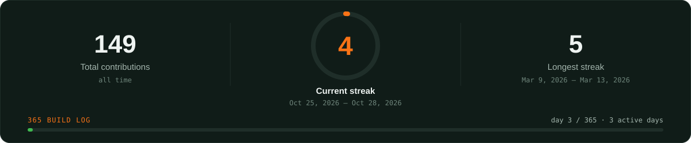

  

  
  
  
  

I build computer vision systems that work on real data and run outside a notebook: finding and classifying buildings from above, and making models fast enough for small hardware.

## Now

| | Role | What I work on |
| :---: | --- | --- |
| 🏢 | **Working student · Fraunhofer IEE** | Building classification from aerial imagery across Bavaria |
| ⚡ | **HiWi · BTU MeReVeS** | Power and performance benchmarking of video workloads on an NXP i.MX8M Plus |
| 🎓 | **Master's thesis · BTU Cottbus-Senftenberg** | AI-supported building detection and classification from aerial imagery |
| 📅 | **365 Build Log** | One real unit of work every day, Oct 2026 → Oct 2027 (live progress below) |

## Projects

| Project | Area | What it does | Status |
| --- | --- | --- | --- |
| [**yolo-video-analytics**](https://github.com/AssadKhurshid/yolo-video-analytics) | Computer Vision | Detection + tracking for line counting and zone occupancy, as a CLI and an API |  |
| **aerial-building-segmentation** | Computer Vision | Building footprints from open aerial imagery, exported as GeoJSON |  |
| **geo-agent** | Agentic AI | LLM agent that calls my segmentation model as a tool to answer map questions |  |
| **edge-vision-benchmark** | Edge AI | FP32 vs INT8 ONNX on small hardware: latency, size and accuracy |  |

## Tech

  
  
  
  
  
  
  
  
  

## 365 Build Log

<picture>
  <source media="(prefers-color-scheme: dark)" srcset="assets/snake-dark.svg">
  
</picture>
